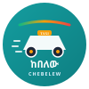

# Chebelew (ከበለው) - Ethiopia Ride-Hailing Aggregator & Dispatch Platform

<p align="center">
  
</p>

<p align="center">
  <strong>"Get there faster with Chebelew" • "በከበለው በፍጥነት ይድረሱ"</strong><br />
  <em>The one-stop ride-hailing aggregator and hybrid dispatch marketplace built specifically for Addis Ababa and Ethiopia.</em>
</p>

---

## 🇪🇹 Executive Summary & Market Fit

Ethiopia's ride-hailing landscape is vibrant and dense (~40+ apps in Addis Ababa), led by incumbents **RIDE (Hybrid Designs PLC)** and **Feres (Feres Technologies)**. However, riders multi-home across multiple apps to find available vehicles, prices vary, and no platform offers unified comparison or hybrid dispatch.

**Chebelew** solves this with a **Hybrid Marketplace Aggregator**:
1. **Aggregator & Live Price Comparison**: Side-by-side fare and ETA comparisons across Chebelew Standard, RIDE, Feres, and local taxi cooperatives.
2. **Direct Hybrid Dispatch**: Dispatches from our independent vetted driver fleet while allowing authorized cooperative fleets to integrate.
3. **Telebirr & Cash Payments**: Native integration with Ethio Telecom's **Telebirr** (60M+ users) supporting dynamic QR codes, simulated USSD push (`*127#`), and instant driver wallet payouts alongside cash.
4. **Ethiopian VAT Regulation No. 570/2025 Compliance**: Implements the May 2026 Ethiopian VAT directive requiring ride-hailing platforms to remit 15% VAT on full ride fares, with electronic VAT tax receipts and automated tax reporting for the Ministry of Revenues.
5. **Call-Center Fallback**: Dedicated manual dispatch console for phone-in bookings (e.g. dialing 9922) catering to offline users and feature-phone passengers.
6. **Full Localization**: Seamless 1-click toggle between **አማርኛ (Amharic)** with Ethiopic script and **English**.

---

## 🏛 System Architecture

The platform is designed as a modular, cloud-ready architecture:

```
chebelew/
├── client/                     # Frontend Client (React 18 + TypeScript + Vite + TailwindCSS)
│   ├── src/
│   │   ├── components/
│   │   │   ├── Map/AddisMap.tsx          # Leaflet map with Addis Ababa landmarks & live cars
│   │   │   ├── Rider/RiderView.tsx      # Passenger booking, aggregator comparison & tracking
│   │   │   ├── Driver/DriverView.tsx    # Driver online toggle, GPS simulator & wallet
│   │   │   ├── Admin/AdminView.tsx      # Dispatch console, KYC queue & VAT ledger
│   │   │   ├── Payment/TelebirrModal.tsx# Telebirr QR & USSD payment flow
│   │   │   ├── Payment/VatReceiptModal.tsx # Ministry of Revenues VAT Tax Receipt
│   │   │   ├── Split/SplitView.tsx      # Side-by-side Rider & Driver live simulator
│   │   │   └── Navbar.tsx               # Role switcher, Amharic toggle, 1-Click Demo
│   │   ├── i18n/translations.ts         # Full Amharic & English dictionaries
│   │   └── utils/audio.ts               # Web Audio API alerts & chimes
├── server/                     # Backend API & Real-time Gateway (Node.js + Express + TypeScript)
│   ├── src/
│   │   ├── db/database.ts               # SQLite with WAL mode & Addis Ababa seed datasets
│   │   ├── services/
│   │   │   ├── geoService.ts            # Addis landmarks, road tortuosity & route waypoints
│   │   │   ├── fareService.ts           # Tariffs, VAT Reg 570/2025 & partner comparison logic
│   │   │   ├── telebirrService.ts       # Ethio Telecom Telebirr payment & payout engine
│   │   │   └── dispatchService.ts       # Proximity matcher & manual phone dispatcher
│   │   ├── socket/socketHandler.ts      # Real-time WebSocket channel for GPS tracking
│   │   └── routes/                      # REST routes (auth, rides, drivers, telebirr, admin, geo)
├── shared/                     # Universal TypeScript interfaces shared across client & server
│   └── types.ts
├── Dockerfile                  # Multi-stage production container build
├── docker-compose.yml          # Container orchestration with volume persistence
└── package.json                # Monorepo root orchestrator scripts
```

---

## ⚖️ Ethiopian Value Added Tax (VAT) Regulation No. 570/2025

Under the Federal Democratic Republic of Ethiopia's May 2026 VAT Regulation (No. 570/2025), ride-hailing platforms are classified as taxable suppliers and **must collect 15% VAT on the gross ride fare**:

$$\text{Gross Fare} = \text{Base Fare} + (\text{Distance} \times \text{PerKm}) + (\text{Time} \times \text{PerMinute})$$
$$\text{VAT (15\%)} = \text{Gross Fare} \times 0.15$$
$$\text{Total Fare Paid by Passenger} = \text{Gross Fare} + \text{VAT}$$
$$\text{Platform Commission (15\%)} = \text{Gross Fare} \times 0.15$$
$$\text{Driver Net Payout} = \text{Gross Fare} - \text{Platform Commission}$$

Chebelew provides:
- Itemized upfront fare estimate showing base, distance, time, and 15% VAT.
- Official Ministry of Revenues compliant **Electronic VAT Tax Receipt** with TIN, VAT Registration number, and breakdown.
- Admin **VAT Regulation No. 570/2025 Ledger & Remittance Report** with 1-click CSV/JSON export for tax authorities.

---

## 📱 Mobile Money: Ethio Telecom Telebirr Integration

Chebelew integrates Telebirr with three native payment rails:
1. **Dynamic QR Code**: Real-time QR payload generated using Ethio Telecom merchant credentials (`ETH-TB-99882`) scannable directly in the Telebirr SuperApp.
2. **Direct USSD Push**: Emits `*127*4*MerchantID*Amount#` push notification to the rider's registered phone number.
3. **Instant Driver Payout**: Drivers can withdraw their wallet earnings directly into their Telebirr account 24/7.

---

## 🗺️ Addis Ababa Geospatial Landmark Coverage

Chebelew comes preloaded with accurate coordinates, road tortuosity factors (~1.28), and routing waypoints for key Addis Ababa hubs:
- **Bole International Airport** (ቦሌ ዓለም አቀፍ አውሮፕላን ማረፊያ)
- **Meskel Square** (መስቀል አደባባይ)
- **UNECA Conference Center / Kazanchis** (የተመድ ኢኮኖሚክ ኮሚሽን)
- **Piassa & Churchill Avenue** (ፒያሳ እና ቸርችል ጎዳና)
- **Mexico Square** (ሜክሲኮ አደባባይ)
- **Bole Medhanialem & Edna Mall** (ቦሌ መድኃኔዓለም)
- **Megenagna Roundabout** (መገናኛ አደባባይ)
- **Sarbet & African Union HQ** (ሳርቤት እና የአፍሪካ ህብረት)
- **Addis Mercato** (አዲስ መርካቶ)
- **CMC St. Michael** (ሲኤምሲ ቅዱስ ሚካኤል)
- **Gotera Interchange** (ጎተራ ማስተላለፊያ)

---

## 🚀 Quickstart & Development

### 1. Prerequisites
- Node.js v18+ (tested on Node v22)
- npm or pnpm

### 2. Install & Run Locally

```bash
# Clone the repository
git clone https://github.com/your-org/chebelew.git
cd chebelew

# Run both Server & Client concurrently in dev mode
npm run dev
```

- **Frontend Application**: [http://localhost:5173](http://localhost:5173)
- **Backend API Server**: [http://localhost:4000](http://localhost:4000)
- **API Health Check**: [http://localhost:4000/api/health](http://localhost:4000/api/health)

### 3. Running Automated Tests

```bash
# Run unit & integration tests (13 test cases covering fares, VAT, dispatch, Telebirr, and REST APIs)
npm test
```

### 4. Running via Docker

```bash
docker compose up --build
```

---

## ⚡ 1-Click Interactive Ride Demo

In the web interface:
1. Click the top-right button **"⚡ 1-Click Ride Demo"** (or **"⚡ የ1-ጠቅታ የጉዞ ማሳያ"**).
2. The UI switches automatically into **Split View** (Passenger on the left, Driver on the right).
3. The platform:
   - Creates a booking for **Leila Haile** from Bole Medhanialem to Meskel Square.
   - Alerts nearby driver **Ahmed Mohammed** with an audio chime and 30s countdown.
   - Ahmed accepts the ride; status updates to `ASSIGNED`.
   - Driver marks `ARRIVED at pickup`.
   - Driver starts the trip (`IN_PROGRESS`).
   - The GPS route simulator animates the taxi along the streets of Addis Ababa.
   - Driver completes the trip.
   - Rider initiates and authorizes **Telebirr payment**.
   - Displays the official **Electronic VAT Tax Receipt**!

---

## 👥 Seed Profiles for Testing

| Role | Name | Phone | Vehicle / Function |
|---|---|---|---|
| **Passenger** | Leila Haile | `+251911223344` | Office commuter (Bole) |
| **Passenger** | Tsegaye Wolde | `+251915667788` | Corporate manager (Kazanchis) |
| **Driver 1** | Ahmed Mohammed | `+251912334455` | Toyota Corolla Sedan (`ET-3-A78945`), 4.92★ |
| **Driver 2** | Dawit Bekele | `+251913445566` | Toyota Avanza Minivan 7-Seater (`ET-3-B45210`), 4.88★ |
| **Driver 3** | Bethlehem Girma | `+251914556677` | Toyota Vitz Compact (`ET-3-C88190`), 4.96★ |
| **Driver 4** | Henok Tadesse | `+251917889900` | Hyundai Elantra Comfort VIP (`ET-3-V99021`), 4.95★ |
| **Driver 5** | Solomon Kassahun | `+251918990011` | Lifan 520 (`ET-3-P11234`) - Pending KYC Approval |
| **Dispatcher / Admin**| Almaz Tefera | `+251916778899` | Operations & Dispatch Supervisor |

---

## 📜 License
Proprietary software © 2026 Chebelew Technologies Ethiopia PLC. All rights reserved.
Complies with Ethiopian Ministry of Transport, Ministry of Innovation & Technology (MInT), and INSA security specifications.
